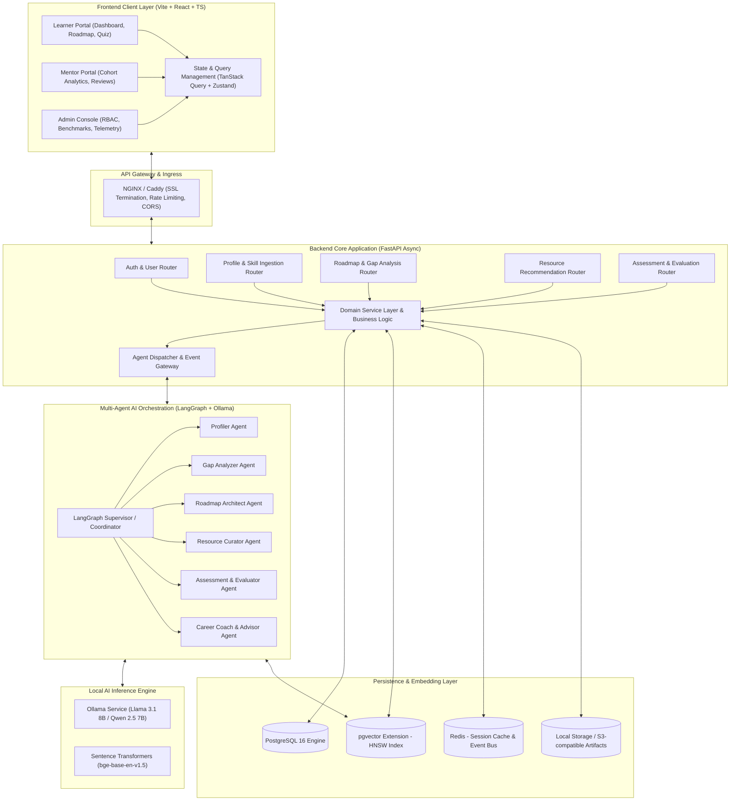
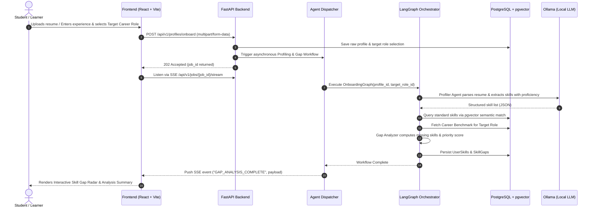
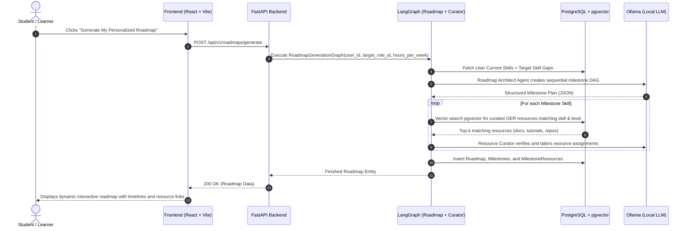

# System Architecture Document
## AI-Powered Personalized Learning & Career Development Platform

**Document Version:** 1.0.0  
**Status:** Approved for Baseline Design  
**Target Milestone:** Phase 1 Architecture & Foundation  

---

## 1. High-Level Architectural Pattern

The platform is designed using a **Modern Decoupled Tiered Micro-Service & Modular Monolith Hybrid Architecture**. It pairs a high-performance **FastAPI asynchronous backend** with a **React + TypeScript frontend (Vite)**, orchestrated alongside an **autonomous Multi-Agent AI subsystem powered by LangGraph and Ollama**, backed by a **PostgreSQL database with pgvector**.

This pattern ensures:
1. Complete separation of concerns between interactive UI, business logic, asynchronous AI workflows, and persistent storage.
2. Low operational complexity without premature microservice fragmentation, while allowing independent horizontal scaling of compute-intensive AI inference workers.
3. Zero lock-in to proprietary cloud APIs by leveraging local, open-source AI and data primitives.



---

## 2. Layered Structural Decomposition

### 2.1 Presentation Tier (Frontend)
- **Framework:** React 18+ with TypeScript, bundled with Vite for ultra-fast HMR and optimized builds.
- **Styling & UI Components:** Tailwind CSS for atomic, responsive styling; Framer Motion for fluid interactive transitions (such as roadmap progression and milestone unlocks); Lucide Icons for consistent iconography.
- **Data Visualization:** Recharts for skill radar charts, mastery velocity area graphs, and cohort gap heatmaps.
- **Client State & Caching:** 
  - **TanStack Query (React Query):** Server-state caching, automatic background refetching, mutation management, and optimistic UI updates.
  - **Zustand:** Lightweight global UI state (user session, theme, active roadmap step, audio/sidebar toggles).
- **Network Transport:** Axios / Fetch with automatic JWT authorization header injection and 401 refresh token interceptors; WebSocket client for real-time AI agent status streaming and SSE for token-by-token roadmap rendering.

### 2.2 Application / API Tier (FastAPI Backend)
- **Framework:** FastAPI running on top of Uvicorn (ASGI), providing native Python asynchronous I/O (`async/await`) for high-throughput concurrent request handling.
- **Input Validation & Serialization:** Pydantic v2 for strict schema enforcement, automatic JSON schema generation, and high-performance Rust-based data parsing.
- **Data Access & ORM:** SQLAlchemy 2.0 with asynchronous driver (`asyncpg`), using declarative ORM models and Alembic for automated, reversible database migrations.
- **Dependency Injection:** FastAPI's `Depends` pattern utilized for authentication context, database session lifetime management, and service isolation.

### 2.3 Multi-Agent AI Orchestration Tier
- **Framework:** LangGraph (StateGraph) integrated with LangChain core abstractions.
- **Agent Execution Model:** Directed Acyclic and Cyclic Graphs with persistent state checkpointing.
- **Agent Communication:** Shared blackboard state pattern (`AgentState`) where individual specialized agents inspect prior state outputs, execute domain tasks (with tool calling or structured Pydantic outputs), and append results to the global state.
- **Local LLM Runner:** Ollama hosting quantized open-source models (e.g., `llama3.1:8b-instruct-q4_K_M` or `qwen2.5:7b-instruct-q4_K_M`).
- **Semantic Vector Processing:** HuggingFace `sentence-transformers` running locally on CPU/GPU (`BAAI/bge-base-en-v1.5` or `all-MiniLM-L6-v2`) generating 768-dimensional or 384-dimensional dense vectors.

### 2.4 Data & Persistence Tier
- **Relational Database:** PostgreSQL 16 storing structured entities (Users, Organizations, Roles, Skill Taxonomies, Roadmaps, Milestones, Submissions, Quizzes).
- **Vector Search Extension:** `pgvector` enabled within PostgreSQL to store and query dense vector embeddings using Hierarchical Navigable Small World (HNSW) indexing with cosine similarity (`vector_cosine_ops`).
- **Caching & Ephemeral Broker:** Redis for session token blacklisting, rate limiting (sliding window), and background task messaging.

---

## 3. End-to-End Application Workflows

### 3.1 Initial Onboarding & Skill Gap Analysis Flow



### 3.2 Dynamic Roadmap Generation & Resource Curation Flow



### 3.3 Dynamic Assessment & Adaptive Re-planning Flow

```mermaid
sequenceDiagram
    autonumber
    actor Learner as Student / Learner
    participant UI as Frontend (React)
    participant API as FastAPI Backend
    participant Evaluator as Evaluator Agent
    participant Replanner as Roadmap Replanner Agent
    participant DB as PostgreSQL

    Learner->>UI: Submits Milestone Quiz / Practical Assessment
    UI->>API: POST /api/v1/assessments/{milestone_id}/submit
    API->>Evaluator: Grade answers and analyze conceptual gaps
    Evaluator->>DB: Update AssessmentResult and UserSkill mastery score
    
    alt Assessment Passed (Score >= 70%)
        Evaluator->>DB: Mark Milestone as COMPLETED; Unlock next milestone
        API-->>UI: Result: Passed (XP + Badge awarded)
    else Assessment Failed (Score < 70%)
        Evaluator->>Replanner: Trigger adaptive remedial branch
        Replanner->>DB: Fetch failed competencies
        Replanner->>DB: Insert Remedial Micro-Milestone with foundational tutorials
        Replanner->>DB: Recalculate estimated completion target dates
        API-->>UI: Result: Review Recommended (Remedial milestone added dynamically)
    end
    UI-->>Learner: Instant visual update of roadmap trajectory
```

---

## 4. Key Cross-Cutting Architecture Decisions (ADR Summary)

1. **ADR-01: Multi-Agent Architecture via LangGraph vs AutoGen/CrewAI**
   - *Decision:* Select **LangGraph**.
   - *Rationale:* LangGraph provides deterministic, cycle-aware state machines, explicit control over state transitions, persistent checkpointing in PostgreSQL, and first-class streaming support. It avoids uncontrolled multi-agent runaway loops common in purely reactive agent frameworks.

2. **ADR-02: PostgreSQL + pgvector as Unified Store vs Dedicated Vector DB (Pinecone/Milvus/Qdrant)**
   - *Decision:* Use **PostgreSQL with `pgvector`**.
   - *Rationale:* Eliminates data synchronization drift between relational entities (users, roadmaps, enrollments) and vector embeddings. HNSW indexing in `pgvector` provides sub-50ms query times for our scale with zero extra licensing costs and simplified single-database operational overhead.

3. **ADR-03: Ollama for Localized Zero-Cost Inference**
   - *Decision:* Utilize **Ollama** running open weights models (`llama3.1:8b`, `qwen2.5:7b`).
   - *Rationale:* 100% data privacy (student profile and resume data never leave the deployment boundary), zero per-token API costs, and native OpenAI-compatible REST endpoints.
