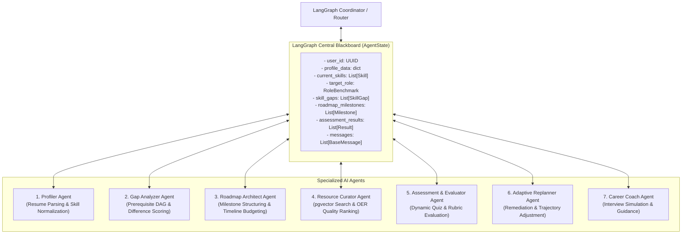
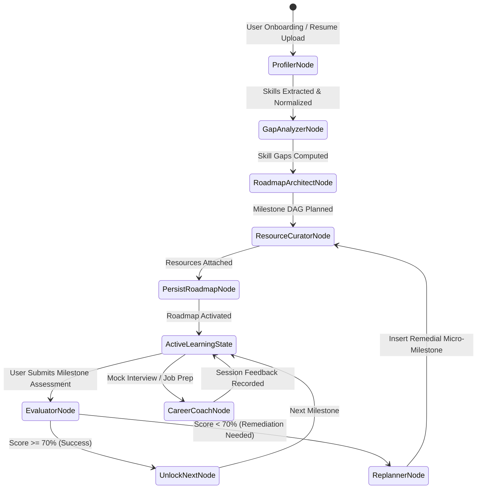

# Multi-Agent AI Architecture Document
## AI-Powered Personalized Learning & Career Development Platform

**Document Version:** 1.0.0  
**Status:** Approved for Baseline Design  
**Framework:** LangGraph + LangChain + Ollama  

---

## 1. Multi-Agent System Overview

The core intelligence of the platform is designed around a **Collaborative Multi-Agent Architecture** orchestrated via **LangGraph**. Rather than relying on a single monolithic prompt, the system decomposes complex learning and career workflows into specialized, deterministic agents. Each agent possesses dedicated system instructions, bounded responsibilities, typed inputs/outputs (validated through Pydantic), and access to specific database/vector tools.



---

## 2. Specialized Agent Specifications

### 2.1 Profiler Agent
- **Primary Mission:** Ingest unstructured learner data (resumes in text/PDF, self-reported summaries, LinkedIn profiles) and transform them into a normalized list of verified and unverified skills with assigned baseline proficiencies.
- **Inputs:** Raw resume text, years of experience, current job title, self-declared competencies.
- **Tools & Capabilities:**
  - `SkillTaxonomyLookupTool`: Matches extracted terms against the canonical database taxonomy using pgvector semantic similarity ($> 0.82$ cosine threshold).
  - Pydantic extractor forcing structured output format: `ExtractedProfile`.
- **Confidence Scoring:** Assigns an initial confidence score:
  - $0.9$: Mentioned in work experience with demonstrable metrics.
  - $0.7$: Mentioned in academic projects or certifications.
  - $0.5$: Listed in a general skills section without contextual evidence.

### 2.2 Gap Analyzer Agent
- **Primary Mission:** Compare the normalized learner profile against target industry role benchmarks, evaluate prerequisite DAGs (Directed Acyclic Graphs), and compute actionable skill deficits.
- **Inputs:** `current_skills`, `target_role_id`, industry benchmark requirements.
- **Logic:**
  1. Retrieves target role competency graph (Mandatory, Recommended, Nice-to-have).
  2. Traverses prerequisites (e.g., *Cannot learn PyTorch before Python and Linear Algebra*).
  3. Computes deficit gap score:
     $$\Delta \text{Proficiency} = \max(0, \text{RequiredLevel} - \text{CurrentLevel})$$
  4. Produces prioritized list of missing skills ordered by prerequisite dependency (topological order) and market impact.

### 2.3 Roadmap Architect Agent
- **Primary Mission:** Synthesize a chronologically ordered, pedagogy-backed learning path tailored to the learner's available study hours per week.
- **Inputs:** `skill_gaps`, `target_role`, `hours_per_week`, `learning_style_preference`.
- **Output:** A structured hierarchical curriculum:
  - **Phases:** High-level themes (e.g., *Phase 1: Foundations of Distributed Systems*).
  - **Milestones:** Discrete learning objectives achievable in 1–2 weeks.
  - **Action Items / Concepts:** Specific sub-competencies to master.
  - **Deliverables:** Tangible artifacts (e.g., *Deploy a containerized REST API with Docker Compose*).
  - **Estimated Study Hours:** Realistic time budget for each milestone.

### 2.4 Resource Curator Agent
- **Primary Mission:** Populate each milestone with top-tier, zero-cost, open educational resources (OER), documentation, and GitHub repositories.
- **Inputs:** Milestone target skills, proficiency level, learner media preference (Text/Video/Code).
- **Tools & Capabilities:**
  - `VectorSearchResourceTool`: Executes HNSW vector similarity query against indexed learning resources in `pgvector`.
  - `LinkValidator`: Validates that URL links are active and not broken.
- **Ranking Formula:**
  $$\text{Score}(R) = w_1 \cdot \text{CosineSim}(v_{\text{skill}}, v_{R}) + w_2 \cdot \text{Rating}_{R} + w_3 \cdot \text{Freshness}_{R}$$
  *(where weights sum to 1.0: $w_1 = 0.6, w_2 = 0.25, w_3 = 0.15$)*.

### 2.5 Assessment & Evaluator Agent
- **Primary Mission:** Generate contextual diagnostic quizzes, evaluate learner submissions (multiple choice, open questions, code snippets), and score mastery.
- **Inputs:** Completed milestone skills, learner code/text submission or quiz responses.
- **Output:**
  - Mastery score ($0 - 100\%$).
  - Granular rubric breakdown: Correctness, Conceptual Understanding, Best Practices.
  - Detailed explanatory feedback identifying exact misconceptions.

### 2.6 Adaptive Replanner Agent
- **Primary Mission:** Dynamically modify an active roadmap when a learner struggles, accelerates, or changes career goals.
- **Trigger Conditions:**
  - Milestone quiz score $< 70\%$.
  - Learner flags a topic as "Too Difficult" or "Too Basic".
  - Inactivity/prolonged pace degradation ($> 2\times$ scheduled time).
- **Action:**
  - Injects a targeted *Remedial Micro-Milestone* breaking the difficult concept into simpler prerequisites.
  - Adjusts target completion dates downstream.
  - Preserves already completed milestones without invalidating prior progress.

### 2.7 Career Coach & Interview Agent
- **Primary Mission:** Conduct interactive role-play mock interviews (technical & behavioral), evaluate resume alignment for specific job descriptions, and recommend career next steps.
- **Inputs:** User's verified skills, target role, mock interview transcript.
- **Output:** Performance radar score across communication, technical depth, and problem-solving, along with targeted areas for improvement.

---

## 3. LangGraph State Machine Architecture

### 3.1 State Schema Definition (`AgentState`)

```python
from typing import Annotated, List, Dict, Any, Optional
from typing_extensions import TypedDict
import operator

class SkillItem(TypedDict):
    skill_id: str
    name: str
    category: str
    proficiency: int  # 1 (Beginner) to 4 (Expert)
    confidence: float # 0.0 to 1.0

class SkillGap(TypedDict):
    skill_id: str
    name: str
    required_level: int
    current_level: int
    gap_magnitude: int
    priority: int
    prerequisites: List[str]

class MilestoneItem(TypedDict):
    milestone_id: str
    title: str
    phase_number: int
    order_index: int
    target_skills: List[str]
    estimated_hours: int
    deliverable_description: str
    recommended_resources: List[Dict[str, Any]]

class AgentState(TypedDict):
    user_id: str
    session_id: str
    raw_input_text: Optional[str]
    current_skills: List[SkillItem]
    target_role_id: str
    target_role_name: str
    hours_per_week: int
    skill_gaps: List[SkillGap]
    roadmap_milestones: List[MilestoneItem]
    active_milestone_id: Optional[str]
    evaluation_feedback: Optional[Dict[str, Any]]
    replan_required: bool
    status: str
    messages: Annotated[List[Dict[str, str]], operator.add]
```

### 3.2 StateGraph Flow & Conditional Transitions



---

## 4. Local LLM Strategy & Inference Optimization (Ollama)

To adhere strictly to zero-cost, privacy-first principles:
1. **Model Hierarchy:**
   - **Primary Instruction Model:** `llama3.1:8b-instruct-q4_K_M` (balanced performance, strong reasoning, 8K context window).
   - **Alternative Code & Reasoning Model:** `qwen2.5-coder:7b-instruct-q4_K_M` (exceptional structured JSON emission and code analysis).
   - **Embedding Model:** `BAAI/bge-base-en-v1.5` (768 dimensions) running via HuggingFace `sentence-transformers` locally.

2. **Structured JSON Output Enforcement:**
   - Pydantic models with `with_structured_output` or Ollama's native JSON mode (`format="json"` with JSON schema validation).
   - Automated Pydantic validator retry loop: if JSON fails validation, error feedback is returned to the model with a max-retry limit of 2.

3. **Deterministic Heuristic Fallbacks:**
   - In the event of local hardware saturation or Ollama service downtime:
     - **Gap Analysis Fallback:** Pure set-difference and relational SQL query against `career_role_skills` and `user_skills`.
     - **Resource Curation Fallback:** Direct SQL HNSW vector nearest neighbor search without agent LLM commentary.
     - **Roadmap Structuring Fallback:** Standard pre-configured template DAG stored in the database for the given career role.
