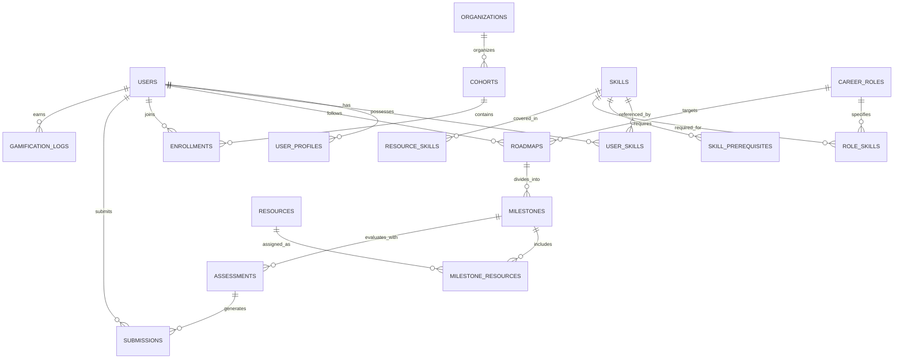

# Database Design and Schema Specification
## AI-Powered Personalized Learning & Career Development Platform

**Document Version:** 1.0.0  
**Database Engine:** PostgreSQL 16+  
**Extensions:** `uuid-ossp`, `pgvector` (0.6.0+)  

---

## 1. Relational & Vector Entity-Relationship (ER) Overview

The database uses a normalized relational model for high-integrity transactional operations (users, roadmaps, evaluations, cohorts) paired with high-dimensional vector embeddings for semantic skill matching and resource recommendations.



---

## 2. Core Relational & Vector Tables DDL

### 2.1 Extension Activation
```sql
CREATE EXTENSION IF NOT EXISTS "uuid-ossp";
CREATE EXTENSION IF NOT EXISTS "vector";
```

### 2.2 Identity & Role-Based Access Control (RBAC)

```sql
-- User Roles Enum
CREATE TYPE user_role_enum AS ENUM (
    'STUDENT',
    'MENTOR',
    'ORG_ADMIN',
    'SYS_ADMIN'
);

-- Organizations
CREATE TABLE organizations (
    id UUID PRIMARY KEY DEFAULT uuid_generate_v4(),
    name VARCHAR(255) NOT NULL,
    slug VARCHAR(100) UNIQUE NOT NULL,
    domain VARCHAR(255),
    is_active BOOLEAN DEFAULT TRUE,
    created_at TIMESTAMPTZ DEFAULT NOW(),
    updated_at TIMESTAMPTZ DEFAULT NOW()
);

-- Users
CREATE TABLE users (
    id UUID PRIMARY KEY DEFAULT uuid_generate_v4(),
    organization_id UUID REFERENCES organizations(id) ON DELETE SET NULL,
    email VARCHAR(255) UNIQUE NOT NULL,
    hashed_password VARCHAR(255) NOT NULL,
    first_name VARCHAR(100) NOT NULL,
    last_name VARCHAR(100) NOT NULL,
    role user_role_enum NOT NULL DEFAULT 'STUDENT',
    is_active BOOLEAN DEFAULT TRUE,
    is_verified BOOLEAN DEFAULT FALSE,
    created_at TIMESTAMPTZ DEFAULT NOW(),
    updated_at TIMESTAMPTZ DEFAULT NOW()
);

-- User Detailed Profiles
CREATE TABLE user_profiles (
    id UUID PRIMARY KEY DEFAULT uuid_generate_v4(),
    user_id UUID UNIQUE NOT NULL REFERENCES users(id) ON DELETE CASCADE,
    headline VARCHAR(255),
    bio TEXT,
    hours_per_week_commitment INT DEFAULT 10,
    preferred_learning_style VARCHAR(50) DEFAULT 'BALANCED', -- 'TEXT', 'VIDEO', 'PROJECT_BASED', 'BALANCED'
    target_career_title VARCHAR(255),
    raw_resume_text TEXT,
    profile_embedding vector(768),
    created_at TIMESTAMPTZ DEFAULT NOW(),
    updated_at TIMESTAMPTZ DEFAULT NOW()
);
```

### 2.3 Skill Taxonomy & Prerequisites

```sql
-- Skill Categories
CREATE TABLE skill_categories (
    id UUID PRIMARY KEY DEFAULT uuid_generate_v4(),
    name VARCHAR(100) UNIQUE NOT NULL,
    description TEXT
);

-- Canonical Skill Catalog
CREATE TABLE skills (
    id UUID PRIMARY KEY DEFAULT uuid_generate_v4(),
    category_id UUID REFERENCES skill_categories(id) ON DELETE RESTRICT,
    name VARCHAR(150) UNIQUE NOT NULL,
    slug VARCHAR(150) UNIQUE NOT NULL,
    description TEXT,
    difficulty_level INT DEFAULT 1, -- 1: Beginner, 2: Intermediate, 3: Advanced, 4: Expert
    skill_embedding vector(768), -- Dense embedding from bge-base-en-v1.5
    created_at TIMESTAMPTZ DEFAULT NOW(),
    updated_at TIMESTAMPTZ DEFAULT NOW()
);

-- Skill Prerequisites (Directed Acyclic Graph)
CREATE TABLE skill_prerequisites (
    id UUID PRIMARY KEY DEFAULT uuid_generate_v4(),
    skill_id UUID NOT NULL REFERENCES skills(id) ON DELETE CASCADE,
    prerequisite_skill_id UUID NOT NULL REFERENCES skills(id) ON DELETE RESTRICT,
    dependency_strength VARCHAR(20) DEFAULT 'MANDATORY', -- 'MANDATORY', 'RECOMMENDED'
    UNIQUE(skill_id, prerequisite_skill_id)
);

-- Learner Possessed Skills
CREATE TABLE user_skills (
    id UUID PRIMARY KEY DEFAULT uuid_generate_v4(),
    user_id UUID NOT NULL REFERENCES users(id) ON DELETE CASCADE,
    skill_id UUID NOT NULL REFERENCES skills(id) ON DELETE CASCADE,
    proficiency_level INT NOT NULL CHECK (proficiency_level BETWEEN 1 AND 4),
    confidence_score NUMERIC(3, 2) DEFAULT 0.50, -- 0.00 to 1.00
    is_verified BOOLEAN DEFAULT FALSE,
    verified_by UUID REFERENCES users(id) ON DELETE SET NULL,
    source VARCHAR(50) DEFAULT 'SELF_REPORTED', -- 'RESUME_EXTRACTED', 'ASSESSMENT_VERIFIED', 'MENTOR_ENDORSED'
    last_assessed_at TIMESTAMPTZ,
    created_at TIMESTAMPTZ DEFAULT NOW(),
    updated_at TIMESTAMPTZ DEFAULT NOW(),
    UNIQUE(user_id, skill_id)
);
```

### 2.4 Career Roles & Industry Benchmarks

```sql
-- Career Roles (e.g. MLOps Engineer, Frontend Engineer)
CREATE TABLE career_roles (
    id UUID PRIMARY KEY DEFAULT uuid_generate_v4(),
    title VARCHAR(200) UNIQUE NOT NULL,
    slug VARCHAR(200) UNIQUE NOT NULL,
    description TEXT,
    industry_demand_level VARCHAR(20) DEFAULT 'HIGH', -- 'MEDIUM', 'HIGH', 'CRITICAL'
    average_salary_range VARCHAR(100),
    created_at TIMESTAMPTZ DEFAULT NOW()
);

-- Role Competency Mapping
CREATE TABLE role_skills (
    id UUID PRIMARY KEY DEFAULT uuid_generate_v4(),
    career_role_id UUID NOT NULL REFERENCES career_roles(id) ON DELETE CASCADE,
    skill_id UUID NOT NULL REFERENCES skills(id) ON DELETE CASCADE,
    required_proficiency INT NOT NULL CHECK (required_proficiency BETWEEN 1 AND 4),
    importance_weight NUMERIC(3, 2) DEFAULT 1.00, -- 0.1 to 2.0 multiplier
    is_mandatory BOOLEAN DEFAULT TRUE,
    UNIQUE(career_role_id, skill_id)
);
```

### 2.5 Dynamic Roadmaps & Milestones

```sql
-- Learning Roadmaps
CREATE TABLE roadmaps (
    id UUID PRIMARY KEY DEFAULT uuid_generate_v4(),
    user_id UUID NOT NULL REFERENCES users(id) ON DELETE CASCADE,
    career_role_id UUID NOT NULL REFERENCES career_roles(id) ON DELETE RESTRICT,
    title VARCHAR(255) NOT NULL,
    status VARCHAR(30) DEFAULT 'ACTIVE', -- 'DRAFT', 'ACTIVE', 'PAUSED', 'COMPLETED'
    version INT DEFAULT 1,
    total_estimated_hours INT DEFAULT 0,
    progress_percentage NUMERIC(5, 2) DEFAULT 0.00,
    created_at TIMESTAMPTZ DEFAULT NOW(),
    updated_at TIMESTAMPTZ DEFAULT NOW()
);

-- Roadmap Milestones
CREATE TABLE milestones (
    id UUID PRIMARY KEY DEFAULT uuid_generate_v4(),
    roadmap_id UUID NOT NULL REFERENCES roadmaps(id) ON DELETE CASCADE,
    phase_number INT NOT NULL DEFAULT 1,
    order_index INT NOT NULL,
    title VARCHAR(255) NOT NULL,
    description TEXT,
    deliverable_title VARCHAR(255),
    deliverable_criteria TEXT,
    estimated_hours INT NOT NULL DEFAULT 10,
    status VARCHAR(30) DEFAULT 'LOCKED', -- 'LOCKED', 'IN_PROGRESS', 'REVIEW_PENDING', 'COMPLETED', 'REMEDIAL'
    is_remedial BOOLEAN DEFAULT FALSE,
    started_at TIMESTAMPTZ,
    completed_at TIMESTAMPTZ,
    created_at TIMESTAMPTZ DEFAULT NOW()
);
```

### 2.6 Educational Resources & Semantic Search

```sql
-- Curated Educational Resources
CREATE TABLE resources (
    id UUID PRIMARY KEY DEFAULT uuid_generate_v4(),
    title VARCHAR(300) NOT NULL,
    url TEXT NOT NULL,
    resource_type VARCHAR(50) NOT NULL, -- 'ARTICLE', 'VIDEO', 'DOCUMENTATION', 'GITHUB_REPO', 'INTERACTIVE'
    difficulty_level INT DEFAULT 1,
    estimated_minutes INT DEFAULT 30,
    provider_name VARCHAR(150), -- 'MDN', 'Coursera OER', 'FreeCodeCamp', 'Official Docs'
    rating NUMERIC(3, 2) DEFAULT 4.50,
    is_free BOOLEAN DEFAULT TRUE,
    content_summary TEXT,
    content_embedding vector(768), -- Dense embedding for semantic matching
    created_at TIMESTAMPTZ DEFAULT NOW(),
    updated_at TIMESTAMPTZ DEFAULT NOW()
);

-- Milestone-Resource Association
CREATE TABLE milestone_resources (
    id UUID PRIMARY KEY DEFAULT uuid_generate_v4(),
    milestone_id UUID NOT NULL REFERENCES milestones(id) ON DELETE CASCADE,
    resource_id UUID NOT NULL REFERENCES resources(id) ON DELETE CASCADE,
    display_order INT DEFAULT 1,
    is_mandatory BOOLEAN DEFAULT TRUE,
    UNIQUE(milestone_id, resource_id)
);
```

### 2.7 Assessments, Submissions & Gamification

```sql
-- Assessments (Quizzes & Practical Challenges)
CREATE TABLE assessments (
    id UUID PRIMARY KEY DEFAULT uuid_generate_v4(),
    milestone_id UUID NOT NULL REFERENCES milestones(id) ON DELETE CASCADE,
    title VARCHAR(255) NOT NULL,
    assessment_type VARCHAR(50) DEFAULT 'QUIZ', -- 'QUIZ', 'CODE_SUBMISSION', 'PROJECT_REVIEW'
    passing_score NUMERIC(5, 2) DEFAULT 70.00,
    questions_payload JSONB, -- Dynamic JSON containing questions, options, rubrics
    created_at TIMESTAMPTZ DEFAULT NOW()
);

-- User Submissions
CREATE TABLE submissions (
    id UUID PRIMARY KEY DEFAULT uuid_generate_v4(),
    assessment_id UUID NOT NULL REFERENCES assessments(id) ON DELETE CASCADE,
    user_id UUID NOT NULL REFERENCES users(id) ON DELETE CASCADE,
    submission_content TEXT, -- Answers JSON or repo URL or text deliverable
    score NUMERIC(5, 2),
    passed BOOLEAN DEFAULT FALSE,
    ai_feedback TEXT,
    evaluator_agent_version VARCHAR(50),
    evaluated_at TIMESTAMPTZ,
    created_at TIMESTAMPTZ DEFAULT NOW()
);

-- Gamification Logs & Badges
CREATE TABLE user_gamification (
    id UUID PRIMARY KEY DEFAULT uuid_generate_v4(),
    user_id UUID UNIQUE NOT NULL REFERENCES users(id) ON DELETE CASCADE,
    current_xp INT DEFAULT 0,
    current_level INT DEFAULT 1,
    streak_days INT DEFAULT 0,
    last_activity_date DATE,
    badges_unlocked JSONB DEFAULT '[]'::jsonb,
    updated_at TIMESTAMPTZ DEFAULT NOW()
);
```

---

## 3. Vector Indexing & Query Optimizations

### 3.1 HNSW Vector Indexing Strategy
To guarantee sub-35ms semantic search latency over skill definitions and curated resources, we construct HNSW (Hierarchical Navigable Small World) indices using cosine distance:

```sql
-- HNSW Index on Skill Embeddings
CREATE INDEX idx_skills_embedding_hnsw ON skills 
USING hnsw (skill_embedding vector_cosine_ops)
WITH (m = 16, ef_construction = 64);

-- HNSW Index on Educational Resource Embeddings
CREATE INDEX idx_resources_embedding_hnsw ON resources 
USING hnsw (content_embedding vector_cosine_ops)
WITH (m = 16, ef_construction = 64);
```

### 3.2 High-Performance Hybrid Search Query
```sql
-- Sample Query: Semantic Retrieval with Hard Filtering (Free resources + Difficulty level)
SELECT 
    id, title, url, resource_type, rating,
    1 - (content_embedding <=> :query_embedding) AS similarity_score
FROM resources
WHERE is_free = TRUE 
  AND difficulty_level <= :learner_max_level
ORDER BY content_embedding <=> :query_embedding ASC
LIMIT 10;
```

---

## 4. Migration & Maintenance Strategy (Alembic)

1. **Version Controlled Migrations:** All schema alterations are authored via Alembic in Python (`alembic revision --autogenerate -m "..."`).
2. **Deterministic Seed Data:** Initial seeds include:
   - Canonical Skill Taxonomy (Software Engineering, Data Science, AI/ML, Cloud & DevOps, Cybersecurity).
   - Core Career Roles (e.g., *Full-Stack Engineer, MLOps Engineer, Cloud Architect, Data Engineer*).
   - Pre-computed 768-dim embeddings for all canonical skills.
