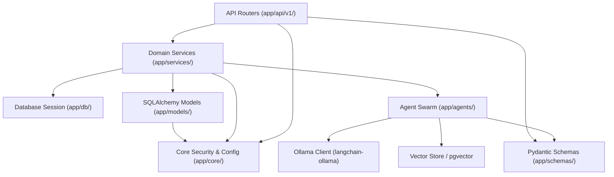

# Application Module Structure & Directory Topology
## AI-Powered Personalized Learning & Career Development Platform

**Document Version:** 1.0.0  
**Repository Pattern:** Monorepo (Decoupled Frontend, Backend & AI Services)  

---

## 1. Monorepo Root Directory Layout

```
ai-learning-platform/
├── .github/                      # CI/CD Workflows (GitHub Actions)
│   └── workflows/
│       ├── backend-ci.yml        # Pytest, Ruff, Mypy checks
│       └── frontend-ci.yml       # Vitest, ESLint, Playwright
├── docker/                       # Docker & Orchestration configs
│   ├── Dockerfile.backend
│   ├── Dockerfile.frontend
│   ├── docker-compose.yml        # Full platform local deployment
│   └── postgres-init.sql         # PGVector extension initialization
├── docs/                         # Architectural & Specifications Documentation
│   ├── 01_SOFTWARE_REQUIREMENTS_SPECIFICATION.md
│   ├── 02_SYSTEM_ARCHITECTURE.md
│   ├── 03_MULTI_AGENT_AI_ARCHITECTURE.md
│   ├── 04_DATABASE_DESIGN_AND_SCHEMA.md
│   ├── 05_TECHNOLOGY_STACK_AND_DEPENDENCIES.md
│   ├── 06_SECURITY_AND_PRIVACY_SPECIFICATION.md
│   ├── 07_DEVELOPMENT_ROADMAP.md
│   └── 08_APPLICATION_MODULE_STRUCTURE.md
├── backend/                      # FastAPI Python Application
│   ├── alembic/                  # Database migration scripts
│   │   ├── versions/
│   │   └── env.py
│   ├── app/                      # Application Source Code
│   │   ├── agents/               # Multi-Agent LangGraph Swarm
│   │   ├── api/                  # API Routers & Endpoints
│   │   ├── core/                 # App configuration & security primitives
│   │   ├── db/                   # Database sessions & pgvector integration
│   │   ├── models/               # SQLAlchemy 2.0 ORM Entities
│   │   ├── schemas/              # Pydantic v2 Request/Response DTOs
│   │   ├── services/             # Domain Business Logic Layer
│   │   └── main.py               # FastAPI application entrypoint
│   ├── tests/                    # Backend Pytest Suite
│   │   ├── unit/
│   │   ├── integration/
│   │   └── conftest.py
│   ├── pyproject.toml            # Backend dependencies & metadata
│   └── alembic.ini
├── frontend/                     # React + Vite + TypeScript Application
│   ├── public/                   # Static assets & favicon
│   ├── src/
│   │   ├── assets/               # Local images & illustrations
│   │   ├── components/           # Reusable generic UI components (Buttons, Modals)
│   │   ├── features/             # Domain Feature Modules
│   │   │   ├── auth/             # Login, Register, Protected Routes
│   │   │   ├── profile/          # Resume upload, Skill tagging
│   │   │   ├── roadmap/          # Interactive milestone visualizer & DAG
│   │   │   ├── gap-analysis/     # Skill gap radar & benchmark comparison
│   │   │   ├── assessments/      # Dynamic quizzes & feedback review
│   │   │   ├── coach/            # Mock interview AI chat
│   │   │   └── admin/            # Cohort management & analytics
│   │   ├── hooks/                # Custom React hooks
│   │   ├── layouts/              # App Shell, Sidebar, Navigation
│   │   ├── routes/               # React Router configurations
│   │   ├── services/             # Axios API client & endpoints
│   │   ├── store/                # Zustand client state stores
│   │   ├── types/                # TypeScript Interfaces & DTOs
│   │   ├── App.tsx
│   │   └── main.tsx
│   ├── package.json              # Frontend dependencies
│   ├── tsconfig.json
│   ├── tailwind.config.js
│   └── vite.config.ts
└── README.md                     # Project Setup & Developer Guide
```

---

## 2. Backend Module Architecture (`backend/app/`)

### 2.1 Subsystem Decomposition
- **`app/core/`**: Centralized configuration (`config.py` loading `.env`), JWT token security (`security.py`), and custom exception handlers.
- **`app/db/`**: Asynchronous SQLAlchemy session lifecycle (`session.py`), base model classes, and vector type conversions.
- **`app/models/`**: Declarative relational tables:
  - `user.py`, `organization.py`, `skill.py`, `career_role.py`, `roadmap.py`, `resource.py`, `assessment.py`, `gamification.py`.
- **`app/schemas/`**: Pydantic models for validation and serialization (e.g., `UserCreate`, `UserResponse`, `SkillGapResponse`, `RoadmapGenerateRequest`, `AssessmentSubmissionRequest`).
- **`app/agents/`**: Multi-agent implementation:
  - `state.py`: LangGraph `AgentState` TypedDict definition.
  - `graph.py`: StateGraph assembly, conditional edges, and checkpoint setup.
  - `profiler_agent.py`: Resume parsing & skill normalization node.
  - `gap_analyzer_agent.py`: Benchmark comparison and topological deficit sorting.
  - `roadmap_architect_agent.py`: Sequential milestone synthesis node.
  - `resource_curator_agent.py`: Semantic vector retrieval and OER selection.
  - `evaluator_agent.py`: Assessment grading and rubric generation.
  - `replanner_agent.py`: Remedial milestone insertion and trajectory updating.
- **`app/services/`**: Business domain services decoupling endpoints from raw DB/Agent interactions (`auth_service.py`, `profile_service.py`, `roadmap_service.py`, `vector_service.py`).
- **`app/api/v1/`**: Versioned API routers:
  - `auth.py`, `profiles.py`, `skills.py`, `career_roles.py`, `roadmaps.py`, `assessments.py`, `admin.py`.

---

## 3. Frontend Module Architecture (`frontend/src/`)

### 3.1 Feature-Sliced Structural Pattern
The frontend follows a **Feature-Driven Architecture** where each domain capability encapsulates its own UI components, hooks, and API queries:
- **`features/auth/`**: Auth views, token interceptors, role guards.
- **`features/gap-analysis/`**: Recharts radar charts comparing learner skills vs. role requirements.
- **`features/roadmap/`**: Interactive milestone tree, step-by-step progress tracking, Framer Motion animations.
- **`features/assessments/`**: Dynamic quiz questions, real-time timer, instant AI grading modal.
- **`features/coach/`**: AI mock interview chat interface with streaming message bubbles.
- **`features/admin/`**: Cohort skill matrices, user management tables, telemetry widgets.

---

## 4. Module Dependency Graph


This clean unidirectional flow prevents circular dependencies and guarantees strict separation of concerns.
